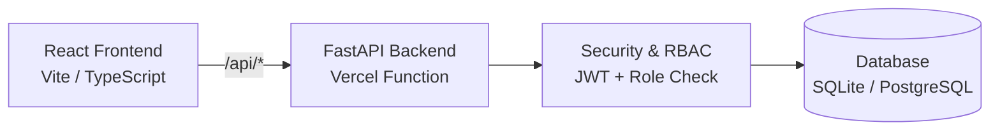
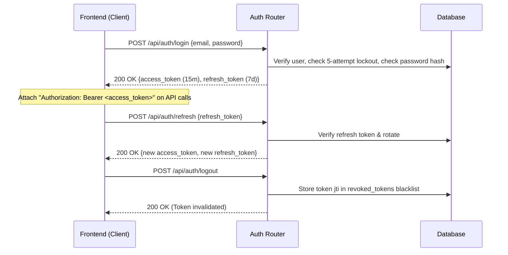

# Campus Lost & Found Management System

A secure web-based lost-and-found management platform for campus communities: report lost or found items, search and filter belongings, and coordinate recovery through campus team desks. Built with a FastAPI backend and a React + TypeScript frontend, deployed on Vercel.

> **Status:** MVP and Beta features are complete: lost & found report CRUD, search & filtering, JWT authentication (access & rotating refresh tokens), token revocation blacklist, 5-attempt brute-force lockout, RBAC roles (`user`, `moderator`, `admin`), campus team desks, and live Vercel deployment.

---

## Features

### MVP (Mid-term)
- **Report Management:** Create, browse, view, update, and delete lost and found reports.
- **Search & Filters:** Real-time filtering by report type (`Lost` / `Found`) and category.
- **REST API:** FastAPI backend with interactive documentation at `/api/docs`.
- **Local Integration:** React frontend connected to FastAPI REST endpoints with local SQLite storage.

### Beta (Final)
- **JWT Authentication:** Secure user registration, login, and logout with short-lived access tokens (15 min) and rotating refresh tokens (7 days).
- **Token Revocation:** Tokens are blacklisted in the database upon logout so they cannot be reused.
- **Brute-Force Lockout:** Account is automatically locked for 15 minutes after 5 consecutive failed login attempts.
- **Role-Based Access Control (RBAC):**
  - `user`: Manage personal profile and edit/delete own reported items.
  - `moderator`: Campus desk staff (Security, Library, IT Helpdesk) managing items assigned to campus desks.
  - `admin`: Full system control—manage all reports, user roles, accounts, and system analytics.
- **Item Ownership Rules:** Regular users cannot modify or delete items created by other students.
- **Campus Team Desks:** Designated campus recovery points (`Security Desk`, `Library Front Desk`, `IT Helpdesk`).
- **Profile Dashboard:** View account details, role status, own reported items, and change passwords.
- **Cloud Deployment:** Production deployment on Vercel with HTTPS and PostgreSQL support.

---

## Tech Stack

| Layer | Technology | Purpose |
|---|---|---|
| **Frontend** | React 18, TypeScript, Vite | Fast, typed, modern user interface |
| **Backend** | Python 3.10+, FastAPI | High-performance async REST API |
| **ORM / Data** | SQLModel / SQLAlchemy | Database models and schema management |
| **Database** | SQLite (local dev), PostgreSQL (production) | Structured data persistence |
| **Authentication** | PyJWT, Passlib (Argon2 / PBKDF2) | Cryptographic token handling and password hashing |
| **Testing** | Pytest | Automated security and RBAC test suite |
| **Hosting** | Vercel | Full-stack cloud hosting via `vercel.json` |

---

## Documentation

| Document | Purpose | File |
|---|---|---|
| **PRD** | Product Requirements Document — goals, user stories, and milestones | [docs/01-prd.md](docs/01-prd.md) |
| **SRS** | Software Requirements Specification — functional/non-functional requirements, RBAC matrix | [docs/02-srs.md](docs/02-srs.md) |
| **TDD** | Technical Design Document — architecture, data models, REST endpoints, security | [docs/03-tdd.md](docs/03-tdd.md) |
| **Final Report** | Comprehensive course submission report and viva defense guide | [docs/FINAL_REPORT.md](docs/FINAL_REPORT.md) |

---

## Project Structure

```text
backend/
  main.py              # FastAPI application entrypoint and router registration
  models.py            # SQLModel database tables and Pydantic schemas
  database.py          # Engine configuration, session dependency, and table creation
  security.py          # Password hashing, JWT token create/verify, lockout checks
  rbac.py              # Role-based dependencies (require_role, get_current_user)
  crud.py              # Database queries for items, users, groups, and tokens
  service.py           # Business logic, seed data, and ownership enforcement
  routers/
    items.py           # Report CRUD endpoints with ownership rules
    auth.py            # Registration, login, token refresh, and logout
    profile.py         # Profile dashboard and password change
    admin.py           # User management and admin metrics
  tests/
    test_auth_and_rbac.py # 7 automated pytest tests for lockout, tokens, and RBAC

frontend/
  src/
    App.tsx            # Main state container and view router
    api.ts             # REST client with automatic 401 token refresh
    types.ts           # Shared TypeScript interfaces (Item, User, Group)
    components/        # UI components (Header, ItemCard, ItemList, FilterBar, Modals)
    pages/             # Pages (LoginPage, SignupPage, ProfilePage, AdminPage)

docs/
  01-prd.md            # Product Requirements Document
  02-srs.md            # Software Requirements Specification
  03-tdd.md            # Technical Design Document
  FINAL_REPORT.md      # Course Final Project Report

vercel.json            # Routes /api/* to FastAPI and all other paths to frontend
```

---

## How It Works

### Architecture Flow



### Authentication & Token Rotation



---

## Demo Accounts

The database is pre-seeded with accounts representing each system role:

| Name | Email | Role | Permissions |
|---|---|---|---|
| **Ammar Rahman** | `ammar@campus.edu` | `user` | Can manage profile and edit/delete own reports |
| **Sajid Ahmed** | `sajid@campus.edu` | `user` | Can manage profile and edit/delete own reports |
| **Campus Chief Admin** | `admin@campus.edu` | `admin` | Full control: manage all reports, users, roles, and stats |

*(Demo credentials for grading evaluation are provided in the viva submission form and report Appendix).*

---

## Run Locally

### Requirements
- [Python 3.10+](https://www.python.org/downloads/)
- [Node.js 18+](https://nodejs.org/)

### 1. Backend Setup (Terminal 1)

```bash
cd backend
python -m venv .venv
.venv\Scripts\Activate.ps1       # macOS/Linux: source .venv/bin/activate
pip install -r requirements.txt
fastapi dev main.py
```
* Backend runs at: `http://localhost:8000`
* Interactive API docs: `http://localhost:8000/docs`

### 2. Frontend Setup (Terminal 2)

```bash
cd frontend
npm install
npm run dev
```
* Frontend runs at: `http://localhost:5173`
* Vite automatically proxies `/api` calls to the local FastAPI backend.

### 3. Run Automated Tests

```bash
cd backend
pytest tests/test_auth_and_rbac.py -v
```

---

## Environment Variables

| Variable | Required For | Default / Description |
|---|---|---|
| `DATABASE_URL` | Production DB | SQLite path locally; PostgreSQL URL (Neon/Supabase) in production |
| `JWT_SECRET` | Auth Security | Secret key used to sign and verify JWT tokens |
| `ACCESS_TOKEN_EXPIRE_MINUTES` | Token Expiry | `15` (15 minutes lifespan) |
| `REFRESH_TOKEN_EXPIRE_DAYS` | Token Expiry | `7` (7 days lifespan) |

---

## Deploy to Vercel

1. Push the repository to GitHub.
2. In [Vercel Dashboard](https://vercel.com/new), import the repository.
3. Keep **Root Directory** as `./`.
4. Add Environment Variables (`JWT_SECRET`, and optional `DATABASE_URL`).
5. Click **Deploy**. Vercel builds the React frontend and deploys FastAPI serverless functions automatically using `vercel.json`.

---

## Troubleshooting

- **PowerShell script execution disabled:** Run `Set-ExecutionPolicy -Scope CurrentUser RemoteSigned`.
- **FastAPI not found:** Activate the virtual environment (`.venv\Scripts\Activate.ps1`) before running commands.
- **Account locked out:** Wait 15 minutes or test with another seeded demo account.
- **CORS or 500 error:** Ensure backend is running at port 8000 when accessing through Vite frontend.
- **Vercel build error:** Verify that `npm run build` succeeds locally in `frontend/`.
