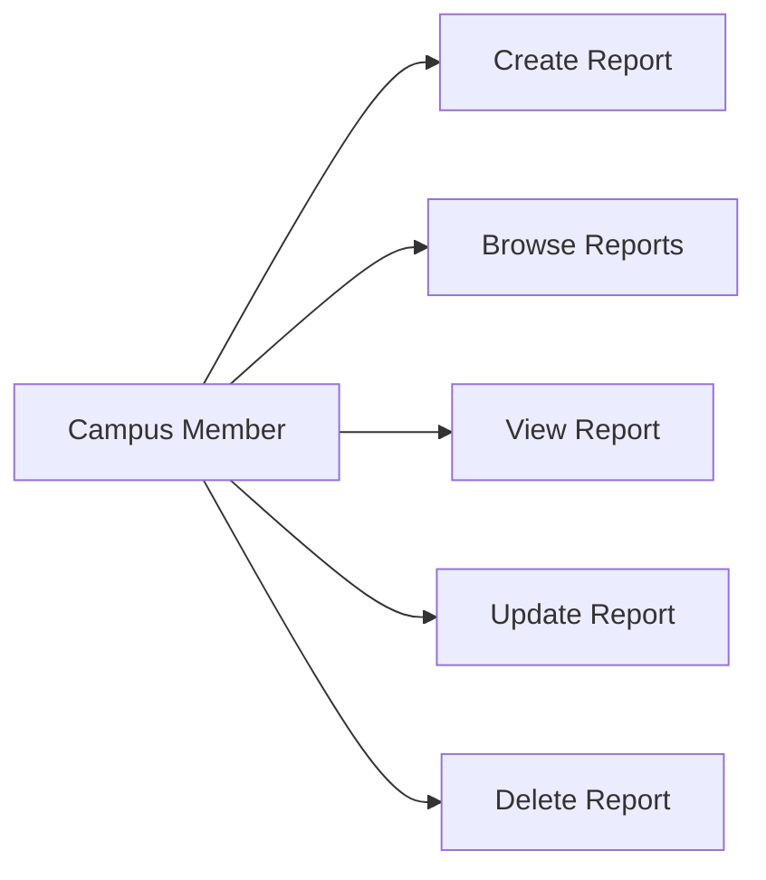
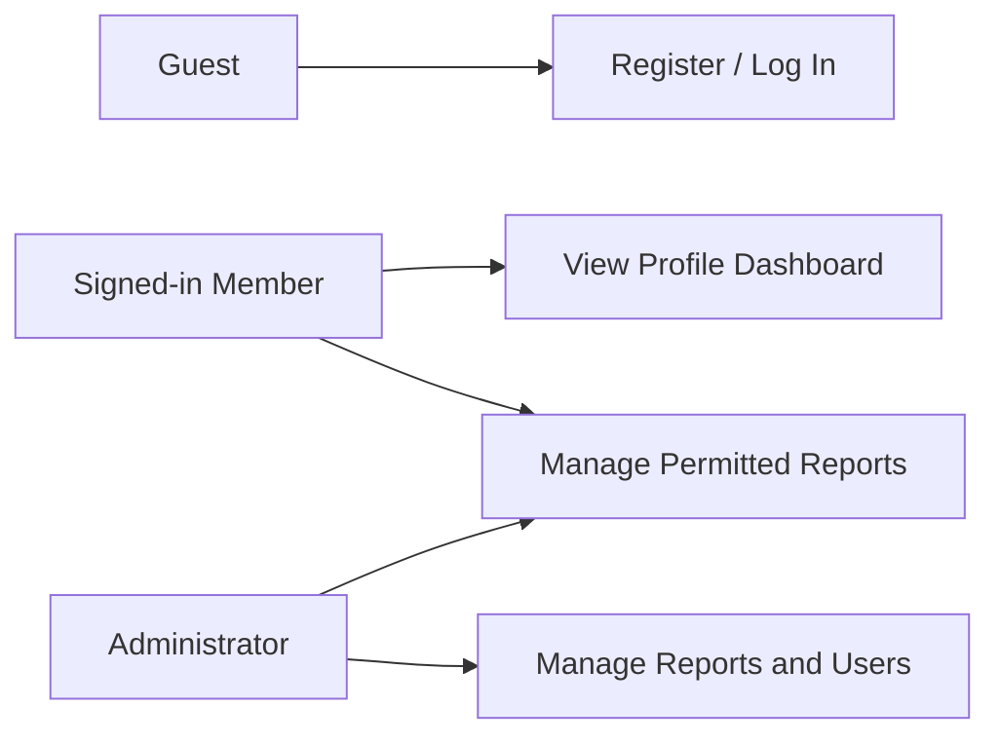

# Software Requirements Specification (SRS)
## Campus Lost & Found Management System

| **Field** | **Details** |
|---|---|
| Product | Campus Lost & Found Management System |
| Releases | MVP (Mid-term) and Beta (Final) |
| Status | Draft |
| Related Documents | [PRD](PRD.md), [TDD](TDD.md) |

---

## 1. Introduction

### 1.1 Purpose

This document defines the software requirements for the Campus Lost & Found application. It describes the functional and non-functional requirements for both the MVP and Beta releases.

### 1.2 Scope

The application will be developed in two releases:

- **MVP (Mid-term):** Users can create, view, update, and delete lost-and-found reports through a REST API. The application will run locally without requiring user authentication.
- **Beta (Final):** The application will introduce user authentication, profiles, member/admin roles, security scopes, permission checks, and deployment.

### 1.3 Definitions

| **Term** | **Meaning** |
|---|---|
| Report | A record describing a lost or found item. |
| CRUD | Create, Read, Update, and Delete operations. |
| REST API | An interface that allows the frontend and backend to communicate using HTTP requests. |
| RBAC | Role-Based Access Control: permissions depend on a user's assigned role. |
| Scope | A specific permission checked by the API before allowing an operation. |
| MVP | Minimum Viable Product: the initial working version of the application. |
| Beta | The enhanced version of the application prepared for the final release. |

---

## 2. Users and Roles

| **User** | **Release** | **Description** |
|---|---|---|
| Local User | MVP | Uses the application without signing in. |
| Member | Beta | Signs in and manages their own profile and reports. |
| Admin | Beta | Has additional permissions to manage reports and users. |

---

## 3. Functional Requirements

### 3.1 Report Management — MVP

| **ID** | **Requirement** | **Release** |
|---|---|---|
| FR-01 | The system shall allow users to create a lost or found report containing a title, description, category, and location. | MVP |
| FR-02 | The system shall display a list of reports and allow users to view individual reports by ID. | MVP |
| FR-03 | The system shall allow users to update and delete existing reports. | MVP |
| FR-04 | The API shall validate report data and return clear error messages for invalid input or missing reports. | MVP |
| FR-05 | Users shall be able to create, view, update, and delete reports through the React frontend integrated with the FastAPI REST API. | MVP |
| FR-06 | The application shall run locally without requiring user accounts or authentication. | MVP |

### 3.2 Authentication and Permissions — Beta

| **ID** | **Requirement** | **Release** |
|---|---|---|
| FR-07 | Users shall be able to register, log in, and log out of the application. | Beta |
| FR-08 | The system shall provide a profile dashboard for authenticated users. | Beta |
| FR-09 | The system shall support `member` and `admin` roles. Public registration shall not grant administrator privileges. | Beta |
| FR-10 | The API shall enforce user roles, security scopes, and report ownership when performing protected actions. | Beta |
| FR-11 | The API shall reject requests with missing or invalid authentication using HTTP `401` and requests with insufficient permissions using HTTP `403`. | Beta |
| FR-12 | The application shall be deployed and accessible for the final demonstration. | Beta |

---

### 3.3 Permission matrix — Beta

| Action | Guest | Registered User (`user`) | Campus Staff (`moderator`) | Administrator (`admin`) |
|---|---|---|---|---|
| Browse / search public lost & found reports | Yes | Yes | Yes | Yes |
| View single report details | Yes | Yes | Yes | Yes |
| Sign up, log in | Yes | — | — | — |
| Refresh token, log out | No | Yes | Yes | Yes |
| View own profile, change password | No | Yes | Yes | Yes |
| Create a new report | No | Yes | Yes | Yes |
| Edit / delete own report | No | Yes | Yes | Yes |
| Edit / delete another user's report | No | No (`403`) | Yes (Desk items) | Yes (All reports) |
| Manage campus team desks (`Security`, `Library`, `IT`) | No | No (`403`) | Yes | Yes |
| List all users, change user roles | No | No (`403`) | No (`403`) | Yes |
| View admin dashboard metrics & stats | No | No (`403`) | No (`403`) | Yes |

### 3.4 Status codes

| Case | Code | Release |
|---|---|---|
| Resource created successfully | `201 Created` | MVP |
| Read or update operation succeeded | `200 OK` | MVP |
| Deleted successfully or logged out | `204 No Content` / `200 OK` | MVP & Beta |
| Validation failed (e.g. empty title, bad type) | `422 Unprocessable Content` | MVP |
| Resource not found | `404 Not Found` | MVP |
| Duplicate / business conflict | `409 Conflict` | MVP & Beta |
| Unexpected server error | `500 Internal Server Error` | MVP |
| Missing, invalid, or expired JWT token | `401 Unauthorized` | Beta |
| Insufficient role permissions or ownership check failed | `403 Forbidden` | Beta |
| Account locked due to repeated failed login attempts (5 times) | `429 Too Many Requests` | Beta |

## 4. Non-Functional Requirements

| **ID** | **Requirement** | **Release** |
|---|---|---|
| NFR-01 | The frontend shall be developed using React with TypeScript, and the backend shall use FastAPI with Python. | MVP |
| NFR-02 | The frontend and backend shall communicate through JSON-based REST APIs. | MVP |
| NFR-03 | Invalid data and failed requests shall return clear error messages and shall not be presented as successful operations. | MVP |
| NFR-04 | User passwords shall be securely hashed, and sensitive configuration values or secrets shall not be committed to the repository. | Beta |
| NFR-05 | Authorization and permission checks shall be enforced by the backend rather than relying only on frontend controls. | Beta |
| NFR-06 | The deployed application shall use HTTPS to secure communication between clients and the server. | Beta |

---

## 5. Acceptance Criteria

### 5.1 MVP Acceptance Criteria

The MVP will be accepted when:

- The application starts and runs successfully in a local environment.
- Users can create, list, view, update, and delete lost-and-found reports.
- Invalid report data is rejected with appropriate API error messages.
- The React frontend successfully communicates with the FastAPI REST endpoints.
- Report information is stored and retrieved correctly from the local database.

### 5.2 Beta Acceptance Criteria

The Beta release will be accepted when:

- Users can register, log in, and access their profile dashboard.
- Members cannot perform administrator-only actions.
- Members cannot access or modify another member's protected data without authorization.
- The backend correctly enforces the required roles, permissions, and security scopes.
- Passwords are securely stored, and protected API endpoints require valid authentication.
- The application is deployed and accessible over HTTPS.

---

## 6. Use Cases

### 6.1 MVP Use Cases

The following diagram illustrates the main interactions between a campus member and the MVP application.

**Description:**

- **Create Report:** A campus member submits information about a lost or found item.
- **Browse Reports:** A campus member views the available reports.
- **View Report:** A campus member views the details of a specific report.
- **Update Report:** A campus member modifies an existing report.
- **Delete Report:** A campus member removes an existing report.

### 6.2 Beta Use Cases

The following diagram illustrates the interactions between guests, registered members, and administrators in the Beta release.

**Description:**

- **Guest:** Can register or log in to access an account.
- **Signed-in Member:** Can view their profile dashboard and manage permitted reports.
- **Administrator:** Can manage reports and users using administrative permissions.

---

## 7. Traceability

| User Story | Requirements | API Endpoint | Release |
|---|---|---|---|
| Create lost or found report | FR-01, FR-05 | `POST /api/items` | MVP |
| List & search reports | FR-02, FR-05 | `GET /api/items` | MVP |
| View single report | FR-02, FR-05 | `GET /api/items/{id}` | MVP |
| Update report | FR-03, FR-05 | `PUT /api/items/{id}` | MVP |
| Delete report | FR-03, FR-05 | `DELETE /api/items/{id}` | MVP |
| API health check | FR-06 | `GET /api/health` | MVP |
| User registration | FR-07, FR-09 | `POST /api/auth/register` | Beta |
| User login & tokens | FR-07, FR-11 | `POST /api/auth/login` | Beta |
| Session refresh | FR-07, FR-11 | `POST /api/auth/refresh` | Beta |
| User logout & revocation | FR-07, FR-11 | `POST /api/auth/logout` | Beta |
| Profile & change password | FR-08, FR-10 | `GET /api/profile`, `PUT /api/profile/password` | Beta |
| Team desk collaboration | FR-10, FR-11 | `GET /api/groups` | Beta |
| Admin user & role management | FR-09, FR-10 | `GET /api/admin/users`, `PATCH /api/admin/users/{id}/role` | Beta |
| Admin dashboard stats | FR-10 | `GET /api/admin/stats` | Beta |

---
