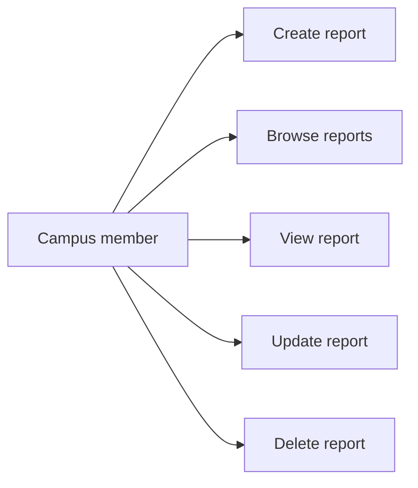

# Software Requirements Specification (SRS) — Campus Lost & Found

| Field | Value |

| Product | Campus Lost & Found Management System |
| Releases | MVP — Mid-term; Beta — Final |
| Status | Draft |
| Related docs | [PRD](PRD.md), [TDD](TDD.md) |

## 1. Introduction

### 1.1 Purpose
This document lists the requirements for the Campus Lost & Found application.

### 1.2 Scope
- **MVP:** Users can create, view, update, and delete lost/found reports through a REST API. The app runs locally.
- **Beta:** Add authentication, user profiles, member/admin roles, security scopes, and deployment.

### 1.3 Definitions

| Term | Meaning |

| Report | A record describing a lost or found item. |
| CRUD | Create, Read, Update, Delete. |
| RBAC | Role-Based Access Control: permissions depend on a user's role. |
| Scope | A specific permission checked by the API. |

## 2. Users and roles

| User | Release | Description |

| Local user | MVP | Uses the app without signing in. |
| Member | Beta | Signs in and manages their own profile and reports. |
| Admin | Beta | Has additional permissions to manage reports and users. |

## 3. Functional requirements

### 3.1 Reports — MVP

| ID | Requirement | Release |

| FR-01 | The system shall create a lost or found report with a title, description, category, and location. | MVP |
| FR-02 | The system shall list reports and allow users to view a report by ID. | MVP |
| FR-03 | The system shall allow users to update and delete reports. | MVP |
| FR-04 | The API shall validate report data and return clear errors for invalid input or missing reports. | MVP |
| FR-05 | Users shall be able to create, view, update, and delete reports through the React frontend and FastAPI REST API. | MVP |
| FR-06 | The application shall run locally without requiring user accounts. | MVP |

### 3.2 Authentication and permissions — Beta

| ID | Requirement | Release |

| FR-07 | Users shall be able to register, log in, and log out. | Beta |
| FR-08 | The system shall provide a profile dashboard for the signed-in user. | Beta |
| FR-09 | The system shall support `member` and `admin` roles. Public registration shall not grant admin access. | Beta |
| FR-10 | The API shall enforce roles, security scopes, and report ownership for protected actions. | Beta |
| FR-11 | The API shall reject requests with missing or invalid authentication (`401`) or insufficient permission (`403`). | Beta |
| FR-12 | The application shall be deployed for the final demonstration. | Beta |

## 4. Non-functional requirements

| ID | Requirement | Release |

| NFR-01 | The frontend shall use React with TypeScript and the backend shall use FastAPI with Python. | MVP |
| NFR-02 | The frontend and backend shall communicate using JSON REST APIs. | MVP |
| NFR-03 | Invalid data and failed requests shall show clear errors and shall not appear successful. | MVP |
| NFR-04 | Passwords shall be securely hashed and secrets shall not be committed to the repository. | Beta |
| NFR-05 | Authorization shall be checked by the backend, not only by frontend controls. | Beta |
| NFR-06 | The deployed application shall use HTTPS. | Beta |

## 5. Acceptance criteria

### MVP
- The application starts locally.
- A user can create, list, view, update, and delete lost/found reports.
- Invalid report data is rejected with a clear API error.
- The frontend successfully uses the FastAPI endpoints.

### Beta
- A user can register and log in and view their profile dashboard.
- A member cannot perform admin-only actions or access another member's protected data.
- The backend enforces the required scopes and roles.
- The application is deployed and accessible over HTTPS.

## Use cases

### MVP use cases

