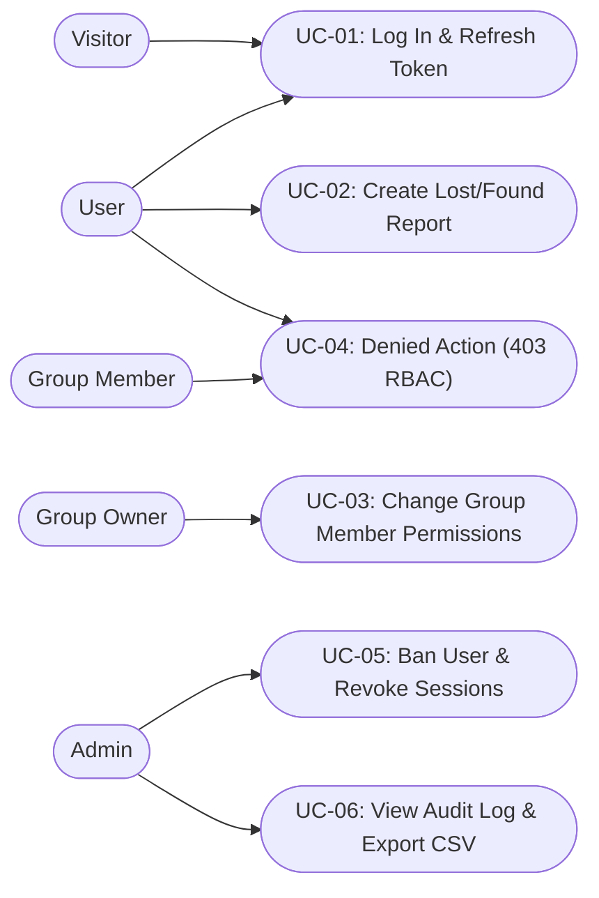
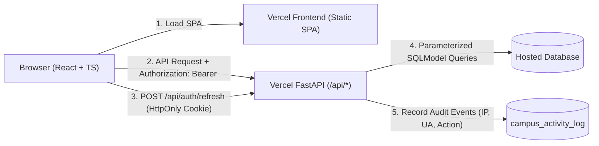
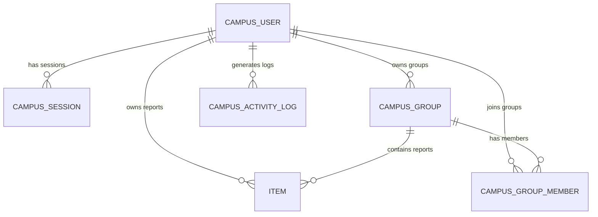
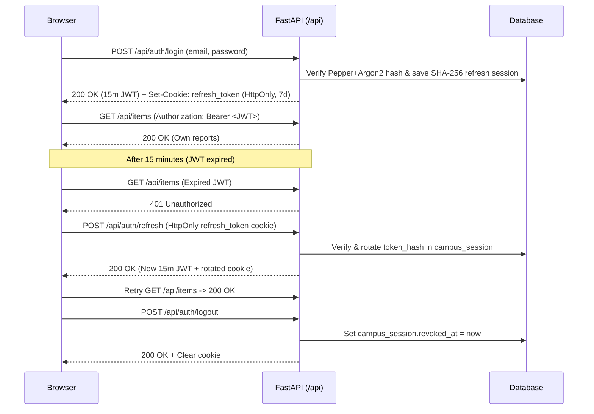
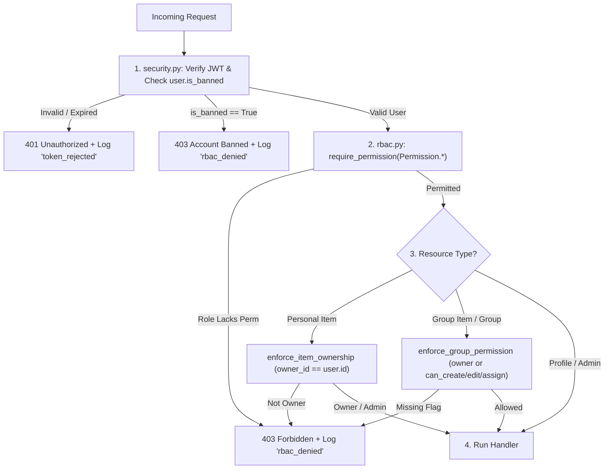
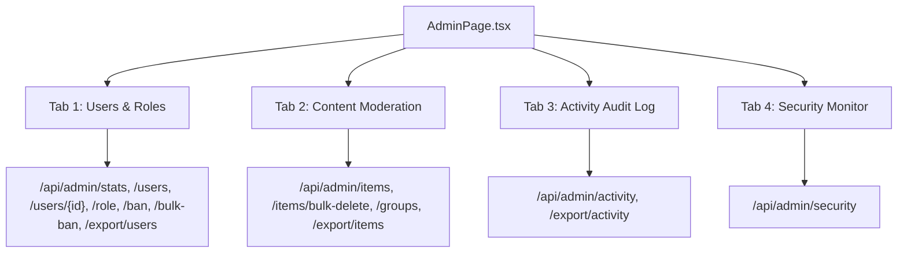
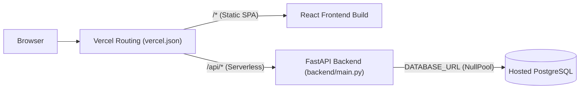

# Final Project Submission Report — Campus Lost & Found Management System

**Independent University, Bangladesh**  
**CSE309 Web Application & Internet**

**Submitted by:**  
- **Name:** Sakif Ishmam  
- **Student ID:** 2220681  
- **Section:** Section 6  
- **Team Number:** N/A  

- **Project Title:** Campus Lost & Found Management System  
- **Vercel URL:** [https://campus-lost-found-management-system.vercel.app](https://campus-lost-found-management-system.vercel.app/)  
- **GitHub Repository:** <https://github.com/Ishmam2222/Campus-Lost-Found-Management-System>  

**Submitted To:**  
Sayef Reyadh  
Adjunct Lecturer  
Department of Computer Science & Engineering  
Independent University, Bangladesh  

- **Semester:** Autumn 2026  
- **Date of Submission:** 26 November 2026

## Table of Contents

- [1. Executive Summary](#1-executive-summary)
- [Part A. Product Requirements (PRD)](#part-a-product-requirements-prd)
- [Part B. Software Requirements (SRS)](#part-b-software-requirements-srs)
- [Part C. Technical Design (TDD)](#part-c-technical-design-tdd)
- [Part D. Evidence: Screenshots of the Running Application](#part-d-evidence-screenshots-of-the-running-application)
- [Part E. Project Management and Conclusion](#part-e-project-management-and-conclusion)

### List of Figures and Screenshots

- **Figure 1:** Use Case Diagram (Part B5)
- **Figure 2:** System Architecture (Part C2)
- **Figure 3:** Database ER Diagram (Part C4)
- **Figure 4:** JWT Login, Refresh & Logout Flow (Part C6)
- **Figure 5:** Request Authorization Flow (Part C7)
- **Figure 6:** Admin Dashboard Pages & Endpoints (Part C8)
- **Figure 7:** Vercel Deployment Layout (Part C10)
- **Screenshots S1–S21:** Live Application Evidence (Part D)

## 1. Executive Summary

### 1.1 Project overview

The **Campus Lost & Found Management System** is a web app for university students, staff, and security desks to report and recover lost or found items on campus. Signed-in users manage their own reports, work together in shared recovery groups (like the Library Desk), and track items from active to claimed and resolved.  
**Stack:** React with TypeScript (Vite), FastAPI with SQLModel, PostgreSQL / SQLite database, deployed on Vercel.

### 1.2 What was built since the mid assessment

- **JWT authentication with refresh and logout:** Added signup, login, Pepper + Argon2 password hashing, 15-minute JWT access tokens, HttpOnly refresh cookies with token rotation, session revocation on logout, and an active sessions list on the Profile page.
- **Role based access control (roles, ownership, group permissions):** Added a single backend/rbac.py module enforcing user and admin roles, strict personal report ownership (users only see and edit their own reports), and shared **Recovery Teams** with per-member can\_create, can\_edit, and can\_assign permissions.
- **Admin dashboard (users, content, activity log, security view, exports):** Built a 4-tab Admin Panel showing 7-day stats, user search/filters, user detail inspection, ban/unban, role changes, bulk delete, activity log, failed login monitor, and CSV downloads.
- **Audit logging, brute-force protection, deployment on Vercel:** Added automatic activity logging (user, IP, browser, time), a 15-minute account lockout after 5 wrong passwords (429), automated pytest tests, and live Vercel deployment.

### 1.3 Live links

**Table 1: Live Links**

| Resource | URL |
| --- | --- |
| **GitHub Repository** | <https://github.com/Ishmam2222/Campus-Lost-Found-Management-System> |
| **Vercel Frontend** | [https://campus-lost-found-management-system.vercel.app](https://campus-lost-found-management-system.vercel.app/) |
| **Vercel API** | <https://campus-lost-found-management-system.vercel.app/api/items> |
| **Vercel API Docs** | <https://campus-lost-found-management-system.vercel.app/api/docs> |
| **Video Demo** | *(Provided in Final Submission Form and PDF Appendix)* |

## Part A. Product Requirements (PRD)

### A1. Problem Statement

Students and staff regularly lose ID cards, calculators, keys, chargers, and notebooks in classrooms, labs, and the library. Today, people post in big Facebook or WhatsApp groups or ask guards at building gates. Those chat posts quickly get buried, have no search or category filter, and nobody can tell if an item was already returned.

Also, campus lost-and-found desks are run by teams of student volunteers across different shifts. Without proper login, ownership rules, and team permissions, anyone could edit or delete another student's report, post spam, or mess up desk records with no way to track who did it.

### A2. Users and Roles

**Table 2: Users and Roles**

| Role | Who They Are | Main Tasks | What They Must Never Be Able To Do |
| --- | --- | --- | --- |
| **Visitor** | Unauthenticated guest | Open the Login or Sign Up page | View, create, edit, or delete any report or call protected APIs (401) |
| **User (user)** | Student or staff member | Create reports, view/edit/delete their own reports, update profile, change password, manage sessions, create/join groups | Read, edit, or delete another user's personal report (403) or open /api/admin/\* (403) |
| **Group Member** | User added to a shared Recovery Team | View group reports and use only the permissions granted to them (can\_create, can\_edit, can\_assign) | Perform ungranted group actions (403), delete group items (403), or manage members/group settings (403) |
| **Group Owner** | Creator of a Recovery Team | Full group control: create, edit, assign, delete group items, rename/delete group, and add/remove members | Access system-wide /api/admin/\* routes or other users' private reports (403) |
| **Admin (admin)** | Campus security moderator | View stats, search/inspect users, change roles, ban/unban users, delete spam reports/groups, view audit & security logs, export CSVs | Change their own role (400) or ban themselves or another admin (400) |

### A3. Goals and Success Measures

**Table 3: Goals and Measures**

| Goal ID | Goal | Testable Measure |
| --- | --- | --- |
| **G-01** | Fast lost and found reporting and filtering | All report CRUD and filter requests finish in < 500 ms with 200/201 status |
| **G-02** | Short-lived, revocable JWT sessions | Access tokens expire in <= 15 minutes; expired, tampered, or logged-out tokens return 401 |
| **G-03** | No user can read or change another user's data | 100% of requests to read, edit, or delete another user's personal report return 403 |
| **G-04** | Fine-grained team permissions work on the server | Members without can\_edit or can\_assign get 403; non-owners get 403 on delete/rename/member changes |
| **G-05** | Brute-force protection and instant ban blocking | 5 wrong passwords lock the account for 15 minutes (429); banned users get 403 on their very next request |

### A4. Scope and Non-Goals

- **In Scope:**
  - Lost & found report CRUD, search, category/type/status filters, and status updates (active, claimed, resolved).
  - Signup, login, logout, Pepper + Argon2 password hashing, 15-min JWT + 7-day HttpOnly refresh cookie rotation, device session revoke, profile update, password change, and 5-attempt lockout.
  - backend/rbac.py module, strict personal ownership, shared Recovery Teams (/api/groups) with can\_create, can\_edit, can\_assign, and frontend ProtectedRoute.
  - Admin dashboard (stats, user list & detail modal, ban/unban, role change, bulk actions, content moderation, activity log, security view, CSV exports) and Vercel deployment.
- **Out of Scope:**
  - *Image uploads:* Skipped to avoid external cloud storage setup and keep the app fast.
  - *Email/SMS notifications:* Skipped so demo testing works without external SMTP servers.
- **Assumptions and Constraints:**
  - Runs on modern browsers with cookies enabled over HTTPS on Vercel serverless functions backed by a hosted database.

### A5. User Stories

**Table 4: User Stories**

| ID | Role | User Story |
| --- | --- | --- |
| **US-01** | Visitor | As a visitor, I want to sign up and log in with my campus email so that I can report lost or found items. |
| **US-02** | User | As a logged-in user, I want my session to refresh automatically and let me revoke old device logins so that my account stays safe. |
| **US-03** | User | As a logged-in user, I want to update my name and change my password after entering my current password so that I can keep my account secure. |
| **US-04** | User | As a report owner, I want only my own reports shown to me and other users blocked from editing or deleting them so that my data stays private. |
| **US-05** | Group Owner | As a group owner, I want to create a recovery team, add members by email, and set each member's create, edit, and assign permissions so that volunteers have appropriate access. |
| **US-06** | Group Member | As a group member with can\_create only, I want to log found items into the team desk while being blocked from editing or deleting existing items. |
| **US-07** | Group Member | As a group member with can\_edit and can\_assign, I want to update item status and assign a handler so the team knows who is handling a return. |
| **US-08** | Admin | As an admin, I want to view 7-day overview stats, filter users, and inspect a user's reports, groups, sessions, and recent activity in one place. |
| **US-09** | Admin | As an admin, I want to ban or unban users (with a reason) and delete inappropriate reports in bulk so that bad actors are stopped immediately. |
| **US-10** | Admin | As an admin, I want to filter the activity log, check failed logins by IP and account, and export users, reports, and logs to CSV. |

## Part B. Software Requirements (SRS)

### B1. Introduction

- **Purpose:** Defines the functional and non-functional requirements, permission rules, use cases, and tests for the Campus Lost & Found Management System.
- **Intended Readers:** Course instructor, teaching assistants, and developers.

| Term | Meaning |
| --- | --- |
| **JWT** | Signed JSON Web Token carrying user claims (sub, email, role, iat, exp). |
| **Access Token** | Short-lived JWT (15 minutes) sent in the Authorization: Bearer header. |
| **Refresh Token** | 7-day random token stored in an HttpOnly cookie and hashed (SHA-256) in campus\_session. |
| **Pepper** | Server-side secret (PASSWORD\_PEPPER) from environment variables mixed into passwords before Argon2 hashing. |
| **RBAC** | Role-Based Access Control enforcing role, ownership, and group permissions on the server. |
| **Audit Log** | Database table (campus\_activity\_log) recording security and user actions with IP, browser, and time. |

- **References:** RFC 7519 (JWT), OWASP ASVS 4.0, FastAPI & SQLModel documentation.

### B2. Functional Requirements

**Table 5: Authentication & JWT Requirements (FR-AUTH)**

| ID | Requirement |
| --- | --- |
| **FR-AUTH-01** | The system shall allow visitors to register (POST /api/auth/register) with name, email, and password (>= 6 chars) with default role user (409 if email exists). |
| **FR-AUTH-02** | The system shall mix passwords with PASSWORD\_PEPPER (HMAC-SHA256) and hash them with Argon2, never storing plain text. |
| **FR-AUTH-03** | The system shall issue a signed HS256 JWT access token (<= 15 minutes) containing sub, email, role, iat, and exp on login. |
| **FR-AUTH-04** | The system shall verify the JWT on every protected request and return 401 if it is missing, malformed, tampered, or expired. |
| **FR-AUTH-05** | The system shall store a SHA-256 hash of the HttpOnly refresh cookie in campus\_session, rotate it on POST /api/auth/refresh, and revoke it on POST /api/auth/logout. |
| **FR-AUTH-06** | The system shall allow users to list their active sessions (GET /api/auth/sessions) and revoke single, other, or all sessions. |
| **FR-AUTH-07** | The system shall lock an account for 15 minutes (429 Too Many Requests) after 5 consecutive failed login attempts. |
| **FR-AUTH-08** | The system shall allow users to update their display name (PUT /api/profile) and change their password (POST /api/profile/password) after verifying their current password. |

**Table 6: RBAC & Group Requirements (FR-RBAC)**

| ID | Requirement |
| --- | --- |
| **FR-RBAC-01** | The system shall store user roles (user, admin) in the database and enforce permissions on the server using one reusable module (backend/rbac.py). |
| **FR-RBAC-02** | The system shall allow normal users to read, edit, or delete only their own personal reports (owner\_id == user.id), returning 403 for other users' reports. |
| **FR-RBAC-03** | The system shall allow users to create shared Recovery Groups (POST /api/groups) where the creator becomes the group owner. |
| **FR-RBAC-04** | The system shall check group member flags (can\_create, can\_edit, can\_assign) and return 403 when a member tries an action they were not granted. |
| **FR-RBAC-05** | The system shall allow only the group owner (or system admin) to delete group reports, rename/delete the group, or add/remove/edit group members (403 otherwise). |
| **FR-RBAC-06** | The system shall block an admin from changing their own role (400) or banning themselves or another admin (400). |
| **FR-RBAC-07** | The system shall check user.is\_banned on every authenticated request and reject a banned user on their very next request with 403. |

**Table 7: Admin Dashboard & Audit Requirements (FR-ADM)**

| ID | Requirement |
| --- | --- |
| **FR-ADM-01** | The system shall provide overview counts (GET /api/admin/stats) including users, admins, banned users, reports, groups, and new users/reports in the last 7 days. |
| **FR-ADM-02** | The system shall provide a paginated user list (GET /api/admin/users) with search and role/status filters, plus a user detail view (GET /api/admin/users/{id}) with reports, groups, sessions, and activity. |
| **FR-ADM-03** | The system shall allow admins to ban/unban users with a reason, change roles, revoke sessions, and run bulk ban/unban actions. |
| **FR-ADM-04** | The system shall allow admins to list and filter all reports and groups, delete single items/groups, and bulk-delete reports. |
| **FR-ADM-05** | The system shall log login, failed login, logout, password change, role change, ban, delete, export, token rejection, and RBAC denial events with user, IP, browser, and time (GET /api/admin/activity). |
| **FR-ADM-06** | The system shall provide a security summary of failed logins by IP and account (GET /api/admin/security) and filter-aware CSV exports (/api/admin/export/users, items, activity). |

**Table 8: Lost & Found Domain Requirements (FR-DOMAIN)**

| ID | Requirement |
| --- | --- |
| **FR-DOMAIN-01** | The system shall allow authenticated users to create lost or found reports (POST /api/items) with type, title, category, location, description, contact info, and status. |
| **FR-DOMAIN-02** | The system shall list the user's reports (GET /api/items) with type, category, status, and keyword filters, and return single report details (GET /api/items/{id}). |
| **FR-DOMAIN-03** | The system shall allow authorized owners, permitted group members, and admins to update report fields/status (PUT /api/items/{id}) and delete reports (DELETE /api/items/{id}). |

### B3. Non-Functional Requirements

**Table 9: Non-Functional Requirements**

| ID | Area | Requirement |
| --- | --- | --- |
| **NFR-01** | Security | Secrets (JWT\_SECRET, PASSWORD\_PEPPER, DATABASE\_URL) come from environment variables (only .env.example in git); failed logins return a generic "Invalid email or password." message. |
| **NFR-02** | Security | Every response sets X-Content-Type-Options: nosniff, X-Frame-Options: DENY, and hides 500 stack traces. |
| **NFR-03** | Performance | User pagination is capped at limit <= 100 (default 10/20) and API calls respond in < 500 ms. |
| **NFR-04** | Usability | Protected pages use ProtectedRoute.tsx with no guest-content flash while restoring sessions, plus responsive loading, error, and empty states. |
| **NFR-05** | Reliability | Production data persists in a hosted database on Vercel (DATABASE\_URL) across restarts. |
| **NFR-06** | Maintainability | All RBAC checks live in backend/rbac.py and 7 automated pytest tests verify auth, lockout, token rejection, and RBAC. |

### B4. Roles and Permission Matrix

**Table 10: Endpoint Groups by Role**

| Endpoint Group | Visitor | User | Group Member | Group Owner | Admin |
| --- | --- | --- | --- | --- | --- |
| GET /api/health, POST /api/auth/register, POST /api/auth/login | Yes | Yes | Yes | Yes | Yes |
| GET/PUT/DELETE /api/items/\* (Personal Reports) | No (401) | **Own** (403 others) | **Own** | **Own** | Yes (All) |
| /api/profile, /api/profile/password, /api/auth/sessions | No (401) | **Own** | **Own** | **Own** | **Own** |
| GET/POST /api/groups | No (401) | Yes | Yes | Yes | Yes |
| POST /api/groups/{id}/items, PUT /api/items/{id} (Group Item) | No (401) | No (403) | **If flag granted** | Yes | Yes |
| DELETE Group Item, PATCH/DELETE /api/groups/{id}, Manage Members | No (401) | No (403) | No (403) | **Yes** | Yes |
| /api/admin/\* (Stats, Users, Moderation, Activity, Security, Exports) | No (401) | No (403) | No (403) | No (403) | **Yes** |

**Table 11: Group Permissions**

| Group Role / Flag | Create Group Item | Edit Group Item & Status | Assign Member | Delete Group Item | Rename/Delete Group & Manage Members |
| --- | --- | --- | --- | --- | --- |
| **can\_create = True** | Yes (201) | No (403) | No (403) | No (403) | No (403) |
| **can\_edit = True** | If can\_create | Yes (200) | If can\_assign | No (403) | No (403) |
| **can\_assign = True** | If can\_create | If can\_edit | Yes (200) | No (403) | No (403) |
| **Group owner** | Yes (201) | Yes (200) | Yes (200) | **Yes (200)** | **Yes (200)** |

**Table 12: Admin Rules**

| Rule | Server Behavior | Status Code |
| --- | --- | --- |
| **Cannot change own role** | PATCH /api/admin/users/{self\_id}/role is blocked | 400 Bad Request |
| **Cannot ban self or another admin** | POST /api/admin/users/{admin\_id}/ban is blocked (and skipped in bulk-ban) | 400 Bad Request |
| **Admin group moderation** | System admins can inspect or delete any group or group report for moderation | 200 OK |

### B5. Use Cases

**Figure 1: Use Case Diagram**



**Table 13: Use Case Descriptions**

| ID & Name | Actor | Preconditions | Main Flow | Alternative / Error Flows | Postconditions |
| --- | --- | --- | --- | --- | --- |
| **UC-01: Log In & Refresh** | User | Account exists, not banned or locked | 1. Submit email & password to POST /api/auth/login.2. Server checks peppered Argon2 hash and logs login.3. Returns 15-min JWT + sets HttpOnly refresh cookie.4. On 401, client calls POST /api/auth/refresh to rotate cookie and get a new JWT. | - Wrong password: 401 + increment fail count.- 5th wrong try: 429 (15m lock).- Banned user: 403. | User has a valid 15-min JWT and active session row. |
| **UC-02: Create a Report** | User | Logged in with valid JWT | 1. Fill report form and submit POST /api/items.2. Server validates fields, attaches owner\_id and owner\_name, saves item, and logs item\_create (201). | - Missing title/location: 422.- Missing/expired token: 401. | Report is saved and shown in the user's report list. |
| **UC-03: Change Member Permissions** | Group Owner | Logged in as group owner | 1. Toggle can\_edit / can\_assign for a member on Recovery Teams page.2. Send PATCH /api/groups/{id}/members/{uid}.3. Server checks owner\_only=True, updates flags, and logs group\_permission\_update (200). | - Caller is not group owner: 403.- Group/member missing: 404. | Member's permissions are updated in campus\_group\_member. |
| **UC-04: Denied Action by RBAC** | User / Member | Logged in without required permission | 1. User tries to edit another user's item, edit a group item without can\_edit, or call /api/admin/stats.2. rbac.py blocks the request, logs rbac\_denied, and returns 403. | - No token or expired token: 401 (token\_rejected). | Action is blocked and recorded in the audit log. |
| **UC-05: Ban a User** | Admin | Logged in as admin | 1. Click Ban on a user and enter a reason (POST /api/admin/users/{id}/ban).2. Server checks target is not an admin, sets is\_banned = True, revokes all user sessions, and logs user\_ban (200). | - Target is self or another admin: 400.- Caller is not admin: 403. | User is banned and blocked on their very next request (403). |
| **UC-06: Read Audit Log & Export** | Admin | Logged in as admin | 1. Open Activity Audit Log tab and filter by event or keyword (GET /api/admin/activity).2. Click Export CSV (GET /api/admin/export/activity), which logs data\_export and downloads the CSV. | - Caller is not admin: 403. | Filtered logs are viewed and downloaded as CSV. |

### B6. Acceptance Criteria

**Table 14: Acceptance Criteria**

| ID | Requirement | Given | When | Then |
| --- | --- | --- | --- | --- |
| **AC-01** | FR-AUTH-04 | A JWT access token has passed its 15-minute exp time | Client calls GET /api/profile with that token | Server returns 401 Unauthorized and logs token\_rejected. |
| **AC-02** | FR-AUTH-04 | A JWT access token's signature is modified | Client sends the tampered token to any protected route | Server returns 401 Unauthorized and logs token\_rejected. |
| **AC-03** | FR-RBAC-02 | student@campus.edu owns report #1 and ammar@campus.edu is logged in | Ammar sends GET, PUT, or DELETE /api/items/1 | Server returns 403 Forbidden and logs rbac\_denied. |
| **AC-04** | FR-RBAC-04 | sajid@campus.edu has can\_create=True, can\_edit=False in the group | Sajid sends PUT /api/items/{group\_item\_id} | Server returns 403 Forbidden. |
| **AC-05** | FR-RBAC-07 | sajid@campus.edu holds a non-expired JWT and an admin bans him | Sajid makes his very next request (GET /api/profile) | Server checks user.is\_banned and returns 403 Forbidden ("Account banned"). |
| **AC-06** | FR-RBAC-06 | admin@campus.edu is logged in | Admin tries to ban moderator@campus.edu or change their own role | Server returns 400 Bad Request. |
| **AC-07** | FR-AUTH-07 | A user account exists | Client sends 5 wrong password attempts in a row | The 5th attempt returns 429 Too Many Requests and locks the account for 15 minutes. |

### B7. Traceability Matrix

**Table 15: Traceability Matrix**

| Requirement ID | Endpoint / Frontend Screen | Automated Test (test\_auth\_and\_rbac.py) | Screenshot |
| --- | --- | --- | --- |
| **FR-AUTH-01, 02** | POST /api/auth/register / SignupPage.tsx | test\_brute\_force\_login\_lockout, test\_login\_and\_refresh\_flow | **S1**, **S19** |
| **FR-AUTH-03, 04** | POST /api/auth/login, security.py / LoginPage.tsx | test\_login\_and\_refresh\_flow, test\_token\_rejection\_missing\_tampered\_and\_expired | **S1**, **S7**, **S21** |
| **FR-AUTH-05, 06** | POST /api/auth/refresh, /logout, /sessions / ProfilePage.tsx | test\_login\_and\_refresh\_flow | **S4**, **S8**, **S12** |
| **FR-AUTH-07** | service.authenticate\_user lockout | test\_brute\_force\_login\_lockout | **S16**, **S21** |
| **FR-AUTH-08** | PUT /api/profile, POST /api/profile/password / ProfilePage.tsx | Verified via Profile API & UI | **S3** |
| **FR-RBAC-01** | backend/rbac.py (require\_permission) | test\_rbac\_rule\_1\_normal\_user\_denied\_admin\_endpoints | **S6**, **S21** |
| **FR-RBAC-02** | backend/rbac.py (enforce\_item\_ownership) | test\_rbac\_rule\_2\_ownership\_prevents\_modifying\_other\_users\_record | **S2**, **S6**, **S21** |
| **FR-RBAC-03, 04, 05** | /api/groups/\*, enforce\_group\_permission / GroupsPage.tsx | test\_rbac\_rule\_3\_fine\_grained\_group\_permissions | **S5**, **S6**, **S21** |
| **FR-RBAC-06, 07** | service.py safety checks, security.py ban check | test\_rbac\_rule\_4\_admin\_safety\_and\_immediate\_ban\_enforcement | **S9**, **S13**, **S21** |
| **FR-ADM-01, 02, 03** | /api/admin/stats, /users, /ban / AdminPage.tsx | test\_rbac\_rule\_1\_..., test\_rbac\_rule\_4\_... | **S10–S13** |
| **FR-ADM-04, 05, 06** | /api/admin/items, /activity, /security, /export/\* | test\_rbac\_rule\_1\_normal\_user\_denied\_admin\_endpoints | **S14–S17** |
| **FR-DOMAIN-01–03** | /api/items/\* / App.tsx, ItemList.tsx | test\_rbac\_rule\_2\_ownership\_prevents\_modifying\_other\_users\_record | **S2**, **S20** |

## Part C. Technical Design (TDD)

### C1. Technology Stack

**Table 16: Technology Stack**

| Component | Technology | Version | Why We Chose It |
| --- | --- | --- | --- |
| **Frontend** | React + TypeScript (Vite) | React 18 / TS 5 | Type safety for API data and fast Vite builds |
| **UI Styling** | Custom CSS3 | CSS Grid/Flex | Clean responsive dark UI with zero extra library bloat |
| **Backend** | FastAPI (Python) | >=0.141 (Py 3.12) | Built-in /api/docs, Pydantic validation, and Depends() for RBAC |
| **ORM** | SQLModel | >=0.0.22 | Combines SQLAlchemy tables and Pydantic schemas in one file |
| **Database** | PostgreSQL / SQLite | Postgres 15 / SQLite 3 | Hosted PostgreSQL for Vercel persistence; SQLite for local dev |
| **Password Hashing** | pwdlib[argon2] + HMAC Pepper | >=0.2 | Argon2 hashing combined with a server-side PASSWORD\_PEPPER secret |
| **JWT Library** | PyJWT | >=2.8 | Standard HS256 JWT signing and expiry verification |
| **Testing** | Pytest + FastAPI TestClient | >=8.0 | Fast automated testing of login, lockout, token tampering, and RBAC |
| **Hosting** | Vercel | Serverless | Hosts both the React SPA and FastAPI /api/\* under one HTTPS domain |

### C2. System Architecture

**Figure 2: System Architecture**



- **Arrows 1–2:** The browser loads the React app from Vercel and sends protected API calls to `/api/*` with `Authorization: Bearer <access_token>`.
- **Arrows 3–5:** When the 15-minute JWT expires, the browser sends the HttpOnly `refresh_token` cookie to `/api/auth/refresh`, while FastAPI queries the database and writes every security and user event to `campus_activity_log`.

### C3. Backend and Frontend Structure

**Backend Folder Tree:**

```text
backend/
  main.py                  # FastAPI app, CORS, security headers, router registration
  models.py                # 6 SQLModel tables and Pydantic request/response schemas
  database.py              # Engine setup (PostgreSQL NullPool / SQLite) and session dependency
  security.py              # Pepper + Argon2 hashing, HS256 JWT, get_current_user dependency
  rbac.py                  # Reusable Permission constants, require_permission, ownership & group checks
  service.py               # Business logic, lockout, token rotation, CSV exports, demo seeding
  crud.py                  # SQLModel database queries
  routers/
    auth.py                # /api/auth (register, login, refresh, logout, sessions)
    profile.py             # /api/profile (update name, change password)
    items.py               # /api/items (lost & found report CRUD)
    groups.py              # /api/groups (recovery teams & member permissions)
    admin.py               # /api/admin (stats, users, bans, moderation, audit, security, CSV)
  tests/
    test_auth_and_rbac.py  # 7 automated pytest tests
```

**Frontend Folder Tree:**

```text
frontend/src/
  main.tsx                 # React entry point
  App.tsx                  # Session restoration, page routing, and report board state
  api.ts                   # Fetch wrapper with silent 401 token refresh and 403 ban logout
  types.ts                 # TypeScript interfaces
  index.css                # Responsive styling
  components/
    ProtectedRoute.tsx     # Route guard blocking guests and non-admins
    Header.tsx             # Role-aware top navbar
    FilterBar.tsx          # Search, type, and category filter bar
    ItemCard.tsx           # Single report card
    ItemList.tsx           # Report grid with empty/loading states
    ItemDetailModal.tsx    # Report detail popup
    ReportModal.tsx        # Create / Edit report popup
  pages/
    LoginPage.tsx          # Login form + demo account quick-select buttons
    SignupPage.tsx         # Registration form
    ProfilePage.tsx        # Name update, password change, and active device sessions list
    GroupsPage.tsx         # Shared Recovery Teams and member permission checkboxes
    AdminPage.tsx          # 4-tab Admin Dashboard
```

### C4. Data Model

**Figure 3: Database ER Diagram**



**Table 17: campus\_user Table**

| Column | Type | Key / Constraint | Purpose |
| --- | --- | --- | --- |
| id | INTEGER | PK | Unique user ID |
| name | VARCHAR(100) | NOT NULL | Display name |
| email | VARCHAR(150) | UNIQUE, INDEX | Login email |
| password\_hash | VARCHAR | NOT NULL | Peppered Argon2 password hash |
| role | VARCHAR(20) | INDEX ('user' / 'admin') | Global RBAC role |
| is\_banned | BOOLEAN | DEFAULT FALSE | Immediate suspension flag |
| ban\_reason / banned\_at | VARCHAR / TIMESTAMP | NULLABLE | Reason and time of ban |
| failed\_login\_count / locked\_until | INTEGER / TIMESTAMP | DEFAULT 0 / NULL | Brute-force lockout tracking |
| last\_login\_at / created\_at | TIMESTAMP | UTC | Login and creation timestamps |

**Table 18: campus\_session Table**

| Column | Type | Key / Constraint | Purpose |
| --- | --- | --- | --- |
| id | INTEGER | PK | Session ID |
| user\_id | INTEGER | FK -> campus\_user.id, INDEX | Session owner |
| token\_hash | VARCHAR(128) | UNIQUE, INDEX | SHA-256 hash of refresh token |
| ip\_address / user\_agent | VARCHAR(64) / VARCHAR(255) | NOT NULL | Device IP and browser |
| created\_at / last\_used\_at / expires\_at | TIMESTAMP | UTC | Session lifecycle timestamps |
| revoked\_at | TIMESTAMP | NULLABLE | Set when logged out or revoked |

**Table 19: campus\_group & campus\_group\_member Tables**

| Table | Columns | Key / Constraint | Purpose |
| --- | --- | --- | --- |
| **campus\_group** | id, name, description, owner\_id, owner\_name, created\_at | id PK, owner\_id FK -> campus\_user.id | Shared Recovery Team metadata |
| **campus\_group\_member** | id, group\_id, user\_id, user\_name, user\_email, group\_role, can\_create, can\_edit, can\_assign, joined\_at | id PK, group\_id & user\_id indexed | Stores 'owner'/'member' and boolean permission flags |

**Table 20: item & campus\_activity\_log Tables**

| Table | Columns | Key / Constraint | Purpose |
| --- | --- | --- | --- |
| **item** | id, type, title, category, location, description, contact\_info, status, owner\_id, owner\_name, group\_id, assignee\_id, assignee\_name, created\_at | id PK, owner\_id & group\_id indexed | Personal and group lost/found reports |
| **campus\_activity\_log** | id, user\_id, user\_email, action, entity\_type, entity\_id, detail, ip\_address, user\_agent, created\_at | id PK, action & user\_id indexed | Audit trail of all security and user actions |

### C5. API Design

All endpoints use the /api prefix and return consistent JSON errors ({"detail": "message"}).

**Table 21: REST API Endpoints**

| Method & Path | Auth | Role / Permission | Request Body | Success / Error Codes |
| --- | --- | --- | --- | --- |
| GET /api/health | No | Public | None | 200 |
| POST /api/auth/register | No | Public | UserCreate | 201 / 409, 422 |
| POST /api/auth/login | No | Public | UserLogin | 200 / 401, 403, 429 |
| POST /api/auth/refresh | Cookie | refresh\_token cookie | None | 200 / 401, 403 |
| POST /api/auth/logout | Optional | Active user/cookie | None | 200 |
| GET /api/auth/sessions | JWT | CurrentUserDep | None | 200 / 401 |
| DELETE /api/auth/sessions/{id} | JWT | CurrentUserDep (Own) | None | 200 / 401, 404 |
| GET/PUT /api/profile | JWT | PROFILE\_MANAGE | ProfileUpdate (on PUT) | 200 / 401 |
| POST /api/profile/password | JWT | PROFILE\_MANAGE | PasswordChange | 200 / 400, 401 |
| GET/POST /api/items | JWT | ITEM\_READ\_OWN / ITEM\_CREATE | ItemCreate (on POST) | 200, 201 / 401, 403 |
| GET/PUT/DELETE /api/items/{id} | JWT | Owner, Group Perm, or Admin | ItemUpdate (on PUT) | 200 / 401, 403, 404 |
| GET/POST /api/groups | JWT | GROUP\_ACCESS | GroupCreate (on POST) | 200, 201 / 401 |
| PATCH/DELETE /api/groups/{id} | JWT | Group owner or admin | GroupUpdate | 200 / 403, 404 |
| GET/POST /api/groups/{id}/members | JWT | Member (GET) / Owner (POST) | GroupMemberAdd | 200, 201 / 403, 404 |
| PATCH/DELETE /api/groups/{id}/members/{uid} | JWT | Group owner | GroupMemberPermissionUpdate | 200 / 400, 403, 404 |
| GET/POST /api/groups/{id}/items | JWT | Group Member (can\_create) | ItemCreate | 200, 201 / 403 |
| GET /api/admin/stats, /users, /users/{id} | JWT | ADMIN\_DASHBOARD | Query filters | 200 / 401, 403 |
| PATCH /api/admin/users/{id}/role | JWT | ADMIN\_USERS\_MANAGE | {"role": "..."} | 200 / 400, 403 |
| POST /api/admin/users/{id}/ban, /unban, /bulk-ban, /bulk-unban | JWT | ADMIN\_USERS\_MANAGE | {"reason": "..."} | 200 / 400, 403 |
| GET /api/admin/items, POST /api/admin/items/bulk-delete | JWT | ADMIN\_CONTENT\_MODERATE | {"ids": [...]} | 200 / 403 |
| GET /api/admin/activity, /security | JWT | ADMIN\_AUDIT\_VIEW | Query filters | 200 / 403 |
| GET /api/admin/export/users, /items, /activity | JWT | ADMIN\_EXPORT | Query filters | 200 (text/csv) / 403 |

### C6. JWT Authentication Design

**Figure 4: JWT Login, Refresh & Logout Sequence**



**Table 22: JWT Access Token Claims**

| Claim | Value | Purpose |
| --- | --- | --- |
| sub | "3" | User ID primary key |
| email | "student@campus.edu" | User email |
| role | "user" or "admin" | Global role |
| iat / exp | UNIX timestamps | Issued-at and 15-minute expiry (iat + 900) |

- **Lifetimes & Storage:** The access token lives for **15 minutes** (signed with HS256 using JWT\_SECRET) so a stolen token expires quickly. The refresh token lives for **7 days** inside an HttpOnly, SameSite=Lax cookie so JavaScript (XSS) cannot read it, while the Authorization: Bearer header + CORS protects against CSRF.
- **Server & Frontend Checks:** On every request, security.py checks the JWT signature, expiry, that the user exists in campus\_user, and that user.is\_banned == False. On a 401, frontend/src/api.ts calls /api/auth/refresh once and retries; if refresh fails, it logs the user out cleanly.

### C7. RBAC Design

**Figure 5: Request Authorization Flow**



- **Reusable Permission Check (`backend/rbac.py`):**

```python
def has_permission(user: User, permission: str) -> bool:
    allowed = ROLE_PERMISSIONS.get(user.role, USER_PERMISSIONS)
    return permission in allowed

def require_permission(permission: str) -> Callable[..., User]:
    def _dependency(
        request: Request,
        session: SessionDep,
        current_user: CurrentUserDep,
    ) -> User:
        if not has_permission(current_user, permission):
            record_security_event(
                session,
                request,
                "rbac_denied",
                f"Denied permission '{permission}' on {request.method} {request.url.path}",
                user_id=current_user.id,
                user_email=current_user.email,
            )
            raise HTTPException(
                status_code=403,
                detail=f"Insufficient permissions: requires '{permission}'.",
            )
        return current_user

    return _dependency
```

- **Query-Level Ownership & Extensibility:** `list_user_scoped_reports` filters SQL directly with `where(Item.owner_id == current_user.id)`, and `enforce_item_ownership` blocks reading, editing, or deleting another user's item (403). Adding a new permission only requires adding a constant to `Permission` and `ROLE_PERMISSIONS` in `backend/rbac.py`.

### C8. Admin Dashboard Design

**Figure 6: Admin Pages and Endpoints**



**Table 23: Admin Tabs, Endpoints, Filters, Actions & Audit Events**

| Tab | Endpoints | Filters & Pagination | Actions | Audit Events |
| --- | --- | --- | --- | --- |
| **Users & Roles** | /api/admin/stats, /users, /users/{id}, /role, /ban, /unban, /bulk-ban, /export/users | Search (name/email), role filter, status filter, pagination (limit=10) | Inspect user drawer, change role, ban/unban with reason, revoke sessions, bulk ban/unban, CSV export | role\_change, user\_ban, user\_unban, session\_revoke, data\_export |
| **Content Moderation** | /api/admin/items, /items/bulk-delete, /groups, /export/items | Search, type (lost/found), category | Delete single or bulk reports, delete group, export items CSV | item\_delete, group\_delete, data\_export |
| **Activity Audit Log** | /api/admin/activity, /export/activity | Search (email, IP, detail), event type filter | Filter audit events, export filtered activity CSV | data\_export |
| **Security Monitor** | /api/admin/security | Grouped by IP and by account | View failed login counts and recent token/RBAC rejections | Read-only view |

### C9. Security Design and Threats

**Table 24: Threats and Defences**

| Threat | Defence in Our Code | File |
| --- | --- | --- |
| **Password DB Leak** | Passwords mixed with server PASSWORD\_PEPPER (HMAC-SHA256) before Argon2 hashing | backend/security.py |
| **Stolen Access Token** | Short 15-minute expiry + DB ban check on every request | backend/security.py |
| **Stolen Refresh Token** | HttpOnly cookie, SHA-256 hashed in DB, rotated on refresh, revocable anytime | backend/routers/auth.py, service.py |
| **Brute-Force Login** | 5 wrong attempts lock the account for 15 minutes (429 Too Many Requests) | backend/service.py |
| **Privilege Escalation** | Signup hardcodes role="user"; role change requires ADMIN\_USERS\_MANAGE | backend/models.py, rbac.py |
| **Reading Others' Data** | SQL query filters by owner\_id == current\_user.id + enforce\_item\_ownership (403) | backend/service.py, rbac.py |
| **XSS** | React JSX auto-escaping, HttpOnly refresh cookies, X-Content-Type-Options: nosniff | backend/main.py, frontend/ |
| **CSRF & CORS Misuse** | Protected calls require Authorization: Bearer header; CORS restricted to FRONTEND\_ORIGIN | backend/main.py, api.ts |
| **Secrets in Git** | .gitignore excludes .env and \*.db; only backend/.env.example is committed | .gitignore, backend/.env.example |
| **SQL Injection** | Parameterized SQLModel select().where() queries everywhere | backend/crud.py |
| **Over-Posting Fields** | Input schemas (UserCreate, ItemCreate, ItemUpdate) exclude role, is\_banned, owner\_id | backend/models.py |

### C10. Deployment on Vercel

**Figure 7: Deployment Layout**



**Table 25: Environment Variables on Vercel**

| Variable Name | Purpose |
| --- | --- |
| DATABASE\_URL | Hosted PostgreSQL connection string |
| JWT\_SECRET | Secret key used to sign and verify HS256 access tokens |
| PASSWORD\_PEPPER | Server-side secret mixed with passwords before Argon2 hashing |
| ACCESS\_TOKEN\_MINUTES | Access token lifetime in minutes (15) |
| REFRESH\_TOKEN\_DAYS | Refresh session lifetime in days (7) |
| FRONTEND\_ORIGIN | Allowed production frontend URL for CORS |

### C11. Testing

We run automated API tests with pytest and FastAPI TestClient in backend/tests/test\_auth\_and\_rbac.py, plus manual verification on the live Vercel deployment.

**Table 26: Automated Test Results**

| Test Name | Requirement(s) | What It Checks | Result |
| --- | --- | --- | --- |
| test\_login\_and\_refresh\_flow | FR-AUTH-03, 05 | Login returns 15m JWT, /api/auth/refresh rotates cookie, /logout revokes session (401 after) | **PASSED** |
| test\_token\_rejection\_missing\_tampered\_and\_expired | FR-AUTH-04, AC-01, 02 | Missing header, bad header, tampered signature, and expired JWT all return 401 | **PASSED** |
| test\_brute\_force\_login\_lockout | FR-AUTH-07, AC-07 | 5 wrong password tries lock the account with 429 Too Many Requests | **PASSED** |
| test\_rbac\_rule\_1\_normal\_user\_denied\_admin\_endpoints | FR-RBAC-01, FR-ADM-\* | Normal user gets 403 on /api/admin/stats, /users, and /export/users | **PASSED** |
| test\_rbac\_rule\_2\_ownership\_prevents\_modifying\_other\_users\_record | FR-RBAC-02, AC-03 | User sees only own items and gets 403 on GET, PUT, or DELETE of another user's item | **PASSED** |
| test\_rbac\_rule\_3\_fine\_grained\_group\_permissions | FR-RBAC-03–05, AC-04 | Sajid (can\_create only) creates (201) but fails edit (403); Ammar (can\_edit) edits (200) but fails owner delete/rename (403); Owner deletes (200) | **PASSED** |
| test\_rbac\_rule\_4\_admin\_safety\_and\_immediate\_ban\_enforcement | FR-RBAC-06–07, AC-05, 06 | Admin self-demote (400) and banning another admin (400) fail; banned user gets 403 on very next request | **PASSED** |

## Part D. Evidence: Screenshots of the Running Application

> *(Full screenshots S1–S21 are embedded in the submitted Word/PDF Report.)*

### D1. User Side

- **[S1: Signup and login page with validation error]** — (FR-AUTH-01, FR-AUTH-03).

- **[S2: Logged-in user's main board showing only their own reports]** (FR-DOMAIN-02, FR-RBAC-02).

- **[S3: Profile page password change rejecting wrong current password]** (FR-AUTH-08).

- **[S4: Active device sessions list on Profile page with Revoke button]** (FR-AUTH-06).

- **[S5: Recovery Teams page showing group members and mixed permissions]** — (FR-RBAC-03, FR-RBAC-04).

- **[S6: Action denied by RBAC with 403 in browser Network tab]** 403 Forbidden enforcement (FR-RBAC-01, FR-RBAC-04).

### D2. Security Behaviour

- **[S7: DevTools Network tab showing masked Authorization: Bearer header and expired token returning 401]** (FR-AUTH-04).

- **[S8: POST /api/auth/refresh returning new access token and HttpOnly cookie in Application tab]** (FR-AUTH-05).

- **[S9: Banned user rejected on their very next request with 403 Account banned]** — (FR-RBAC-07).

### D3. Admin Dashboard

- **[S10: Admin overview statistics with 7-day counts]** — GET /api/admin/stats (FR-ADM-01).

- **[S11: Admin users list with search, role/status filters, and pagination]** — GET /api/admin/users (FR-ADM-02).

- **[S12: User detail inspector modal showing reports, groups, sessions, and recent activity]** — GET /api/admin/users/{id} (FR-ADM-02).

- **[S13: Ban dialog with reason and resulting BANNED status badge]** — POST /api/admin/users/{id}/ban (FR-ADM-03).

- **[S14: Content Moderation list with filters and bulk delete]** — (FR-ADM-04).

- **[S15: Activity Audit Log with filters showing user, event, IP address, and browser]** — GET /api/admin/activity (FR-ADM-05).

- **[S16: Security Monitor showing failed logins by IP and account plus token rejections]** — GET /api/admin/security (FR-ADM-06).

- **[S17: Downloaded CSV export opened]** (FR-ADM-06).

### D4. Deployment

- **[S18: Vercel dashboard showing production deployment and live domain]** (NFR-05).

- **[S19: Vercel environment variable names with values hidden]** — Proves secrets stored in environment variables (NFR-01).

- **[S20: Live FastAPI /api/docs Swagger page on Vercel]** API documentation (Table 1).

### D5. Tests

- **[S21: Terminal output showing all 7 automated tests passing]** — Automated test verification (Table 26).

## Part E. Project Management and Conclusion

### E1. How to Run and Test

1. **Prerequisites:** Python 3.10+, Node.js 18+, and Git.
2. **Clone Repository:**

```bash
git clone https://github.com/Ishmam2222/Campus-Lost-Found-Management-System.git
cd Campus-Lost-Found-Management-System
```

3. **Environment File:** Copy `backend/.env.example` to `backend/.env`:

```env
DATABASE_URL=sqlite:///./lost_and_found.db
JWT_SECRET=local-dev-jwt-secret-key
PASSWORD_PEPPER=local-dev-password-pepper
ACCESS_TOKEN_MINUTES=15
REFRESH_TOKEN_DAYS=7
FRONTEND_ORIGIN=http://localhost:5173
```

4. **Run Backend & Tests:**

```bash
cd backend
python -m venv .venv
.venv\Scripts\activate
pip install -r requirements.txt
pytest -v
fastapi dev main.py
```

5. **Run Frontend:**

```bash
cd ../frontend
npm install
npm run dev
```

6. **Demo Accounts:** The backend seeds test accounts for **admin** and **user** roles plus the shared group *Main Library Lost & Found Team*. Per course rules, the user IDs and passwords are listed only in the **PDF Report Appendix** and the submission form, never in this repository file.

### E2. GitHub Work

All commits and pull requests were completed under my GitHub account (Ishmam2222).

**Table 27: GitHub Issues and Pull Requests**

| Issue | Pull Request / Branch | What It Delivered |
| --- | --- | --- |
| **Issue #1 / #2** | **PR #1, #3** (docs-project-specifications) | Initial project scaffold, Vercel configuration, and mid-term PRD/SRS/TDD docs |
| **Issue #5** | **PR #6, #7** (CRUD/5-report-crud) | Lost & Found CRUD API (/api/items), database models, and React board UI |
| **Issue #8** | **PR #8** (feature/8-auth-and-rbac) | JWT auth, Pepper+Argon2 hashing, refresh cookie rotation, rbac.py, ownership rules, shared Recovery Teams, 4-tab Admin Dashboard, audit log, security view, CSV exports, and 7 automated tests |

### E3. Limitations

- **No Image Uploads:** Reports use text descriptions instead of photo uploads to avoid external cloud storage dependencies.
- **No Email Password Reset:** Password changes require the current password while logged in because no external SMTP server is connected.
- **Manual Audit Refresh:** The Admin Audit Log updates on tab load or click rather than live WebSockets on serverless functions.

### E4. Future Work

1. **Photo Uploads with Cloud Storage:** Allow users to attach item photos using Supabase Storage.
2. **Automatic Lost/Found Match Alerts:** Notify a user when a newly found item matches their lost item's category and location.
3. **QR Code Tags for Desk Items:** Generate printable QR labels for physical items stored at campus recovery desks.

### E5. Sources, Libraries and Tools

**Table 28: Sources, Libraries and Tools**

| Name | Version / Link | What It Was Used For |
| --- | --- | --- |
| **FastAPI & SQLModel** | >=0.141 / >=0.0.22 ([https://fastapi.tiangolo.com](https://fastapi.tiangolo.com/)) | Backend REST API, ORM models, validation, and /api/docs |
| **PyJWT & pwdlib[argon2]** | >=2.8 / >=0.2 ([https://pyjwt.readthedocs.io](https://pyjwt.readthedocs.io/)) | HS256 JWT tokens and Argon2 password hashing |
| **React, TypeScript & Vite** | 18.3 / 5.6 / 6.x ([https://react.dev](https://react.dev/)) | Frontend SPA components, route guards, and bundling |
| **Pytest & HTTPX** | >=8.0 ([https://docs.pytest.org](https://docs.pytest.org/)) | Automated API testing for auth and RBAC |
| **CSE309 Reference (smarter-todo)** | <https://github.com/sayef-reyadh-labs/smarter-todo> | Reference for course JWT, RBAC, and report format expectations |
| **AI Assistant (Gemini / Antigravity)** | Coding & documentation assistant | Helped structure FastAPI routers, React admin tabs, and markdown tables; all RBAC rules, demo accounts, and tests were reviewed and verified by me |

## Appendix. Test Accounts and Video Demo

- **Video Demo Link (5–8 minutes on live Vercel URL):** *(Provided in the Final Submission Form and PDF Report Appendix)*
- **Test Accounts & Passwords:** Per course rules (*never commit passwords to GitHub*), the full table of **2 Admin accounts**, **3 Normal User accounts**, their **passwords**, and the **Main Library Lost & Found Team** member permissions is included in the **Appendix of the submitted PDF Report** and the **Final Submission Google Form**.
