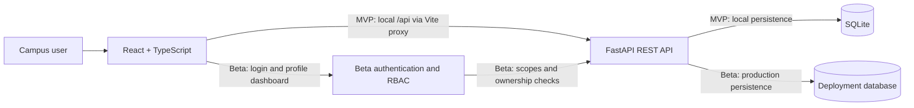

# Technical Design Document (TDD)

**Product:** Campus Lost & Found Management System  
**Version:** 1.1
**Status:** Proposed course-project design
**Task issue:** [#2 — Add project PRD, SRS, and TDD documentation](https://github.com/Ishmam2222/Campus-Lost-Found-Management-System/issues/2)  
**Pull request:** [#3 — Add project PRD, SRS, and TDD](https://github.com/Ishmam2222/Campus-Lost-Found-Management-System/pull/3)

## 1. Purpose and current implementation

This document describes a practical path from the existing scaffold to the
MVP and then Beta. The repository currently contains a React + TypeScript +
Vite frontend, a FastAPI + Python backend, `/api/health` and `/api/hello`
examples, and Vercel routing configuration. Report CRUD, database persistence,
authentication, RBAC, profile dashboard, and security scopes are planned; they
are not currently implemented.

## 2. Release architecture

| Layer | MVP — mid-term, local | Beta — final, deployed |
| --- | --- | --- |
| Frontend | React + TypeScript forms and report list/detail views | Add login/register, profile dashboard, and permission-aware controls |
| Backend | FastAPI REST endpoints for report CRUD and validation | Add authentication, role/scope dependencies, and ownership enforcement |
| Data | Small local SQLite database | Use deployment-compatible persistent storage; migrate data model as required |
| Integration | Vite proxies `/api` to local FastAPI | Deploy frontend and backend with same-origin `/api` routing and HTTPS |



The API is the trust boundary. Beta frontend route guards only improve
usability; all authorization must be checked by FastAPI.

## 3. MVP design

### 3.1 Frontend

- **[MVP]** Keep the existing Vite entry point and implement a small report
  list, report form, and edit/detail view in React components.
- **[MVP]** Use TypeScript types that match the backend report schema.
- **[MVP]** Use a small API module around `fetch` for list/create/read/update/
  delete calls to relative `/api/items` paths.
- **[MVP]** Display loading, empty, validation, network-error, and success
  states; do not present a failed request as successful.

### 3.2 Backend and local data

- **[MVP]** Keep FastAPI and add an item router, Pydantic request/response
  schemas, and a small service/repository layer.
- **[MVP]** Use SQLite for straightforward local setup and persistent report
  data; document how to initialize it. Keep the storage interface separable
  so Beta can use a deployment-compatible database.
- **[MVP]** Validate report type (`lost` or `found`), required fields, and
  field lengths before writing.
- **[MVP]** Do not require accounts for the mid-term CRUD demonstration.
  Authentication and ownership authorization are intentionally Beta work.

### 3.3 MVP REST endpoints

| Method and path | Release | Purpose |
| --- | --- | --- |
| `GET /api/health` | MVP | Service health |
| `GET /api/items` | MVP | Paginated or bounded report list; filter by type/category |
| `POST /api/items` | MVP | Create a report |
| `GET /api/items/{item_id}` | MVP | Read one report |
| `PUT /api/items/{item_id}` | MVP | Replace/update a report |
| `DELETE /api/items/{item_id}` | MVP | Delete a report |

Use JSON request/response bodies, `201 Created` for creation, `404 Not Found`
for missing records, and `422 Unprocessable Entity` for invalid payloads.
Choose either hard delete or soft delete for MVP and use that behavior
consistently; the simplest course-project implementation may hard-delete
reports.

## 4. Beta design

### 4.1 Authentication

- **[Beta]** Add account registration and login endpoints. Normalize email,
  verify credentials, and hash passwords with a maintained adaptive
  password-hashing library.
- **[Beta]** Issue a short-lived signed access token after successful login.
  Validate signature, expiry, subject, and account status in a reusable
  FastAPI dependency.
- **[Beta]** Keep signing keys in protected environment configuration. Never
  return or log password hashes, tokens, or secrets.
- **[Beta]** Public registration always creates the `member` role. Assign
  admin privileges only through a trusted administrative setup path.

### 4.2 RBAC, scopes, and ownership

- **[Beta]** Define server-controlled `member` and `admin` roles and associate
  scopes with each role.
- **[Beta]** Use FastAPI security dependencies to enforce scopes on protected
  endpoints.
- **[Beta]** Apply a resource ownership check after scope validation for
  member-owned report and profile operations.
- **[Beta]** Return `401` when authentication is missing/invalid and `403`
  when an authenticated caller lacks permission.
- **[Beta]** Never trust a role, user ID, or scope supplied in a request body
  to authorize the caller.

Proposed initial permissions:

| Role | Beta scopes |
| --- | --- |
| `member` | `profile:read:own`, `items:read`, `items:create`, `items:update:own`, `items:delete:own` |
| `admin` | Member scopes plus `items:read:any`, `items:update:any`, `items:delete:any`, `users:manage` |

### 4.3 Beta endpoints and dashboard

| Method and path | Release | Access | Purpose |
| --- | --- | --- | --- |
| `POST /api/auth/register` | Beta | Public | Register as a member |
| `POST /api/auth/token` | Beta | Public | Authenticate and issue access token |
| `GET /api/auth/me` | Beta | Authenticated | Read safe current-user profile |
| `GET /api/profile` | Beta | `profile:read:own` | Dashboard profile and own reports |
| Existing `/api/items` operations | Beta | Role/scope + ownership checks | Protect report data/actions |
| `GET /api/admin/items` | Beta | `items:read:any` | Admin report management |

The profile dashboard should be a simple page that summarizes the signed-in
user's safe profile information and their reports. Avoid adding unrelated
analytics, messaging, or social features.

## 5. Proposed code organization

Expand the starter only as requirements arrive; avoid creating empty modules
for features not yet implemented.

```text
backend/
  main.py
  api/routes/items.py       # MVP report endpoints
  schemas/items.py          # MVP Pydantic contracts
  services/items.py         # MVP report rules and persistence
  db/session.py             # MVP local database session
  core/security.py          # Beta password/token/scope helpers
  api/routes/auth.py        # Beta account endpoints
  api/routes/profile.py     # Beta profile dashboard endpoint
frontend/src/
  api/items.ts              # MVP typed report API calls
  features/items/            # MVP list and CRUD forms
  auth/                      # Beta login state and route guards
  features/profile/          # Beta profile dashboard
```

## 6. Data model

### Item report

| Field | Type | Release | Notes |
| --- | --- | --- | --- |
| `id` | Integer or UUID | MVP | Primary key |
| `kind` | Enum/string | MVP | `lost` or `found` |
| `title` | String | MVP | Required, maximum length |
| `description` | Text | MVP | Required, rendered as text |
| `category` | String | MVP | Required/filterable |
| `location` | String | MVP | Required general campus location |
| `created_at`, `updated_at` | Timestamp | MVP | Consistent date/time storage |
| `owner_id` | Account foreign key | Beta | Associates report with its creator |

### Account

| Field | Type | Release | Notes |
| --- | --- | --- | --- |
| `id` | Integer or UUID | Beta | Primary key |
| `email` | String | Beta | Normalized and unique |
| `password_hash` | String | Beta | Adaptive hash only; never exposed |
| `role` | Enum | Beta | `member` or `admin`; server-controlled |
| `is_active` | Boolean | Beta | Disabled accounts cannot authenticate |
| `created_at` | Timestamp | Beta | UTC |

## 7. Frontend/backend integration

- **[MVP]** Use relative `/api` paths in browser code. Vite proxies these to
  the local FastAPI server on port 8000.
- **[MVP]** Keep API request and response types aligned with Pydantic schemas.
- **[MVP]** Parse non-success responses and show the error in the related UI.
- **[Beta]** Attach the access token to protected requests using the agreed
  bearer-token transport.
- **[Beta]** Derive available UI actions from the authenticated profile, while
  treating API responses as authoritative.
- **[Beta]** Use configured same-origin routes or explicit production origins;
  do not hard-code development server addresses into deployed frontend code.

## 8. Security and deployment

- **[MVP]** Validate input at the API boundary and render user content as text.
- **[Beta]** Hash passwords; protect token-signing keys and database credentials
  through environment configuration.
- **[Beta]** Enforce scopes and ownership on the backend, with tests for both
  allowed and denied requests.
- **[Beta]** Serve production traffic over HTTPS and avoid wildcard CORS with
  credentials.
- **[Beta]** Deploy the frontend/backend integration using the repository's
  Vercel routing configuration or another course-approved host.
- **[Beta]** Use persistent production storage; do not rely on ephemeral local
  files for deployed report data.

## 9. Testing plan

- **[MVP] Unit/API tests:** report validation, create/read/update/delete,
  missing-record behavior, and list filtering.
- **[MVP] Integration test:** create and read a report through the API and
  verify the frontend can display it.
- **[Beta] Authentication tests:** registration, login, invalid credentials,
  and expired/invalid tokens.
- **[Beta] Authorization tests:** missing token, insufficient scope, member
  attempting another member's report, and admin-only access.
- **[Beta] Deployment check:** verify HTTPS, configured API routing, persistent
  data configuration, and absence of secrets in browser assets.

## 10. Decisions to confirm

- **[MVP]** Exact category values and maximum field lengths.
- **[MVP]** Whether report deletion is hard delete or soft delete.
- **[Beta]** Which course-approved hosting and persistent database are
  available.
- **[Beta]** How the initial administrator account is provisioned securely.
